# Proxmacs

A Proxmox-flavoured menubar VM manager for Apple Silicon Macs, built on [Tart](https://github.com/openai/tart).

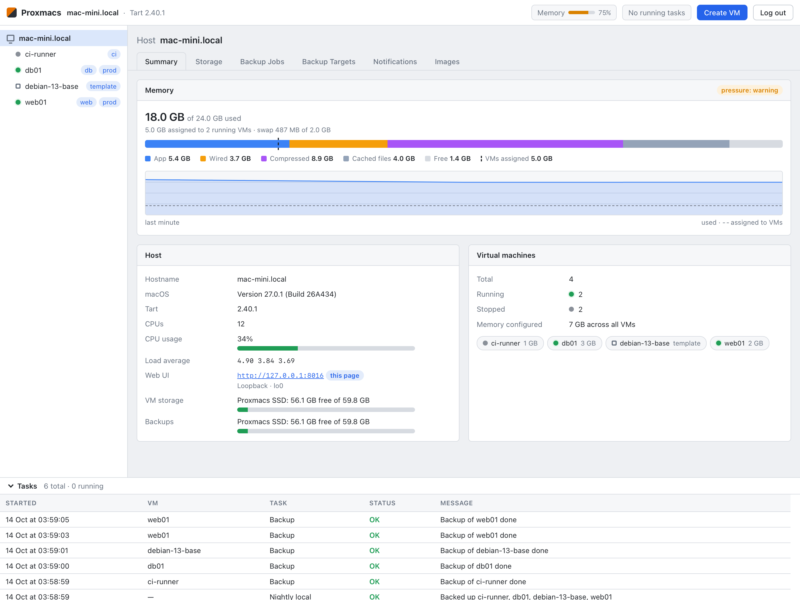

- **Bridged networking**: VMs get their own LAN IP. Tart's official build is signed with Apple's
  `com.apple.vm.networking` entitlement, so it can use Virtualization.framework's native bridge.
- **Cloud images**: arm64 cloud images of Debian 13/12, Ubuntu 26.04/24.04, Fedora 44, Rocky Linux 10/9, AlmaLinux 10/9
  and CentOS Stream 10, or your own `.qcow2`/`.raw`. They are downloaded on first use or ahead of time (Host → Images,
  `cli image-pull`), converted from qcow2 to sparse raw natively (no qemu-img) and cached.
  Provisioned with cloud-init: user (default: the distribution's, e.g. `debian`, `ubuntu`, `rocky`; passwordless sudo),
  SSH keys (default: your `~/.ssh/*.pub`), an optional console password (stored only as a SHA-512 crypt hash), DHCP or a
  static IPv4, and tart-guest-agent (.deb or .rpm).
- **Editing VMs**: CPUs, memory, disk (grow only; the root filesystem grows on next boot), network and nested
  virtualization (Apple M3 or later) while stopped.
  Cloud-init settings (user, password, SSH keys, IP) can be changed any time: the seed is rebuilt with a new
  instance-id and cloud-init re-applies them on the next start. `authorized_keys` ends up exactly as configured, and
  SSH host keys are kept.
- **Extra disks and shared folders**: sparse extra disks (`/dev/vdb`, …; included in backups unless turned off) and
  host folders shared over virtiofs, mounted in the guest at `/mnt/shared/<name>` on every boot (optionally read-only).
- **Clones and templates**: clone any VM, even a running one (its filesystem is frozen for the instant APFS copy),
  with all its disks. The clone gets a new MAC address, and on first boot new SSH host keys and machine-id; a static
  address has to be changed in the clone dialog. Templates can't be started, only cloned.
- **Power**: shutdown (forced after 30 s), stop (at once), reboot through the guest agent, and reset.
- **Monitoring**: per-VM CPU, memory, network and disk I/O charts (last hour, day or week) from the VM's process on
  the host and the guest agent, which also reports the guest's OS, addresses and filesystems. Host CPU usage.
- **Organization**: tags (filter the VM list by name or tag), notes, and start order with startup delays for VMs that
  start on login.
- **Backups**: instant APFS clones. When the guest agent is reachable, the root filesystem is frozen during the clone.
  Backup jobs (Host → Backup Jobs) back up all, selected or all-but-excluded VMs on chosen days at a set time; a run
  missed while the Mac slept is made up within 12 hours. Jobs and Back up now go to local backups or straight to an
  offsite target (SMB or PBS, without a local copy). Retention per VM works like PBS prune: keep the last N, plus
  daily, weekly, monthly and yearly backups.
- **Notifications**: backup jobs post to webhooks (Discord, Slack, ntfy.sh or a self-hosted ntfy, or generic JSON) on
  failure or after every run.
- **External storage**: VM disks and local backups can each live on an external APFS drive (Host → Storage, or
  `cli storage`). Existing VMs and backups are moved along, and disk images stay sparse. While a drive is unplugged,
  its VMs show as *offline* and nothing is written in its place.
- **Offsite backups** push local backups as deduplicated, incremental 4 MiB chunks (only changed chunks travel):
  - **SMB share**: a PBS-like chunk store (`proxmacs-store/`) on any SMB share, mounted on demand via NetFS.
  - **Proxmox Backup Server**: a native Swift client for the PBS backup/reader protocols (HTTP/2 upgrade,
    `disk.img.fidx` + blobs, zstd), authenticated with an API token and certificate fingerprint pinning.
  - Pull a remote snapshot back into local backups. If the VM no longer exists, pulling recreates it.
  - Verify a remote snapshot: every chunk is read back and its digest checked.
- **Web UI**, Proxmox-style, at `https://<mac>:8006` (React + TypeScript, in `web/`): password login, VM list,
  actions and editing, host memory usage (Activity Monitor's breakdown, pressure, swap, memory assigned to running
  VMs, live chart), task log, backups/offsite management, and a browser serial console (xterm.js over WebSocket).
  Scripts use the same JSON API with API keys: see [docs/API.md](docs/API.md).
  The menubar shows a memory gauge too. Works on phones and wide screens, and installs to the home screen as an app.
- **VMs outlive the app**: each VM runs under its own LaunchAgent (`dev.proxmacs.vm.<name>`) as
  `Proxmacs cli run-vm <name>`, which supervises `tart run` and owns the serial console
  (socket `/tmp/proxmacs-<uid>/<name>.sock`, scrollback in `vms/<name>/console.log`).
  Optionally, a VM starts on login.

## Screenshots

| | |
| --- | --- |
| 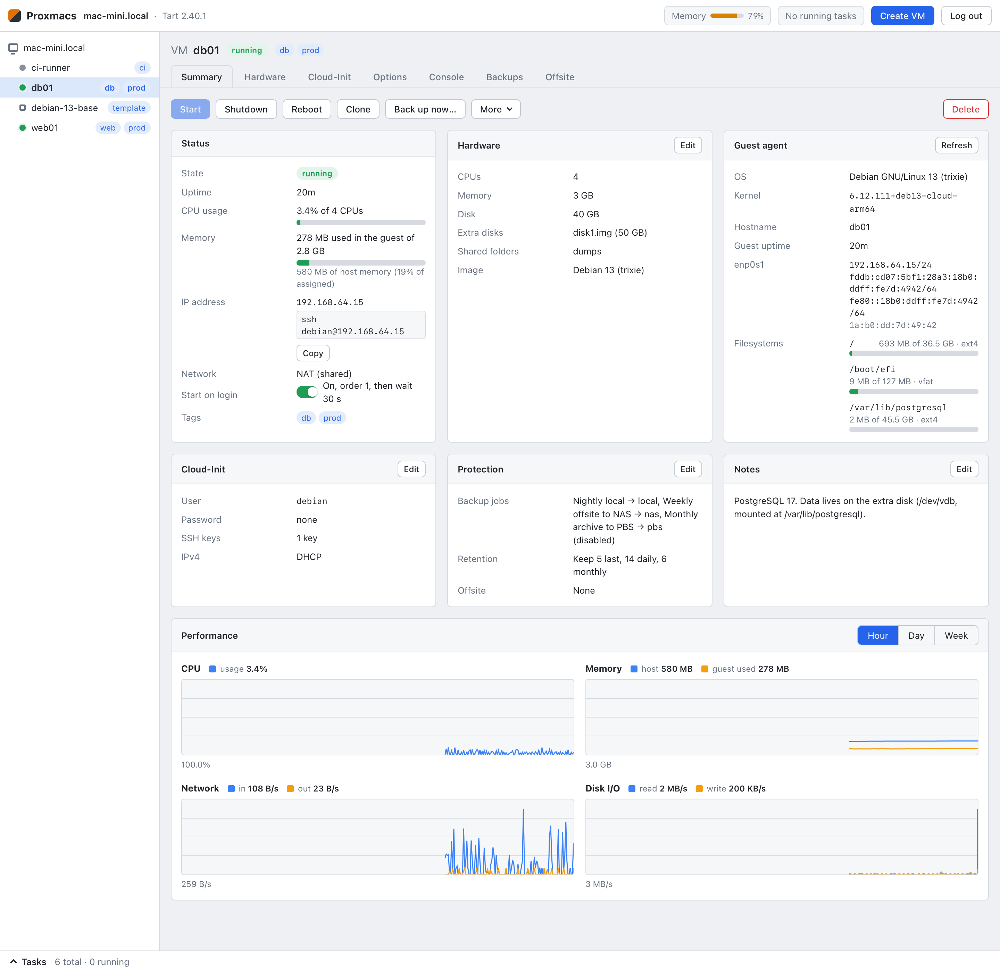 VM summary: usage, guest agent info, notes and performance graphs | 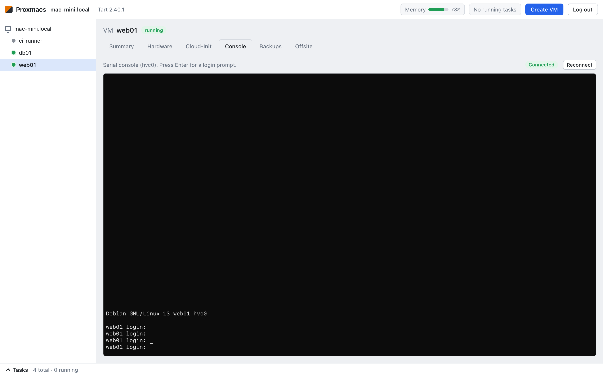 Serial console in the browser |
| 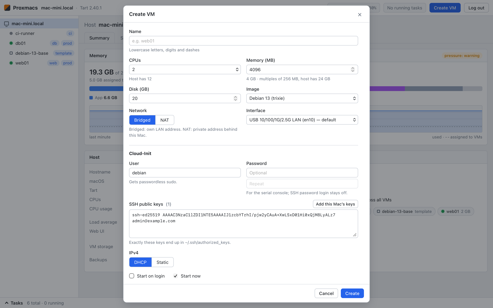 Create VM | 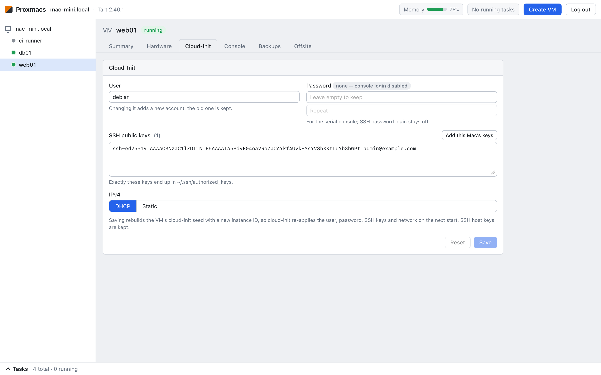 Cloud-init settings |
| 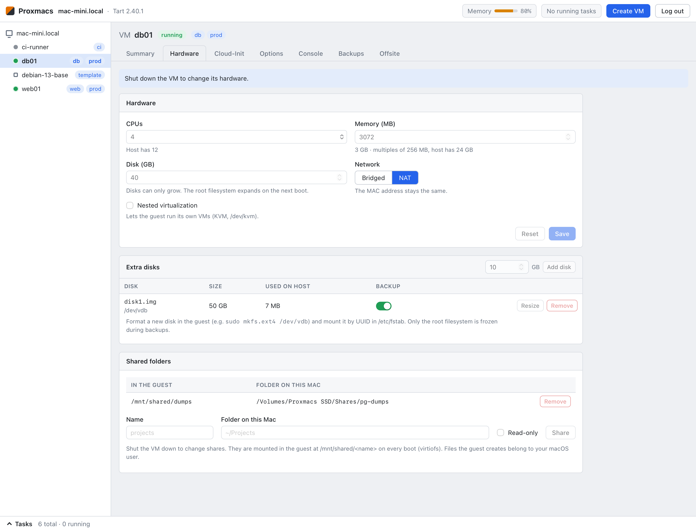 Hardware, extra disks and shared folders | 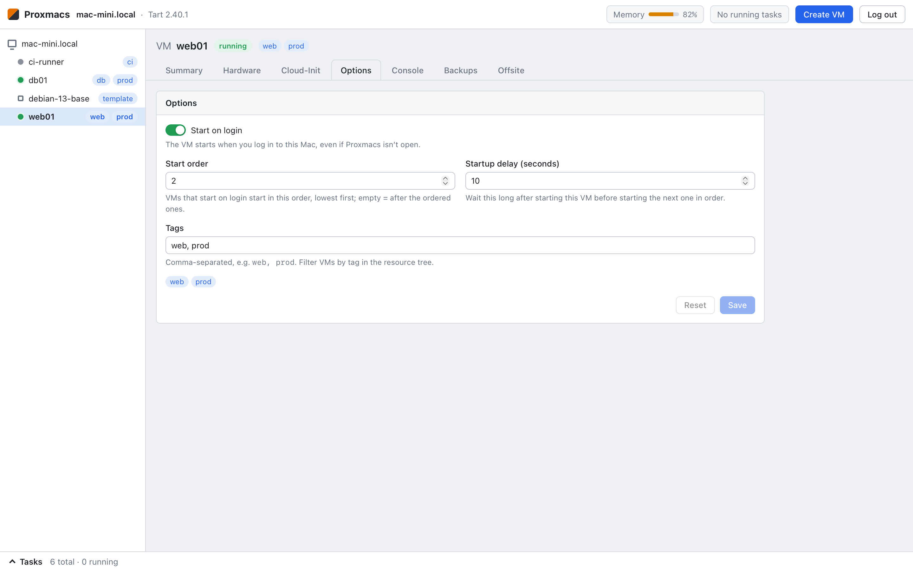 Start on login, start order and tags |
| 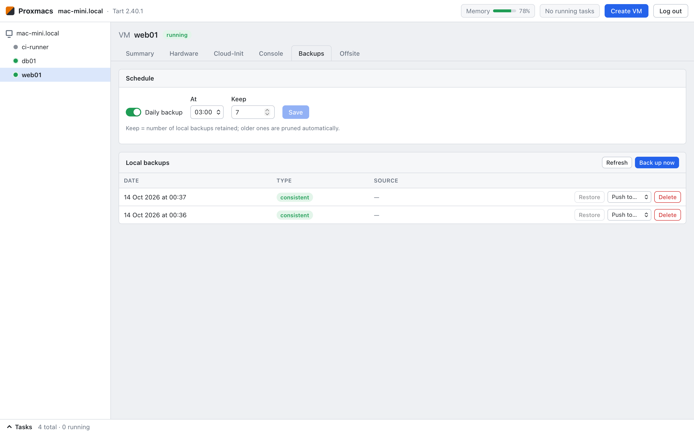 Local backups and retention | 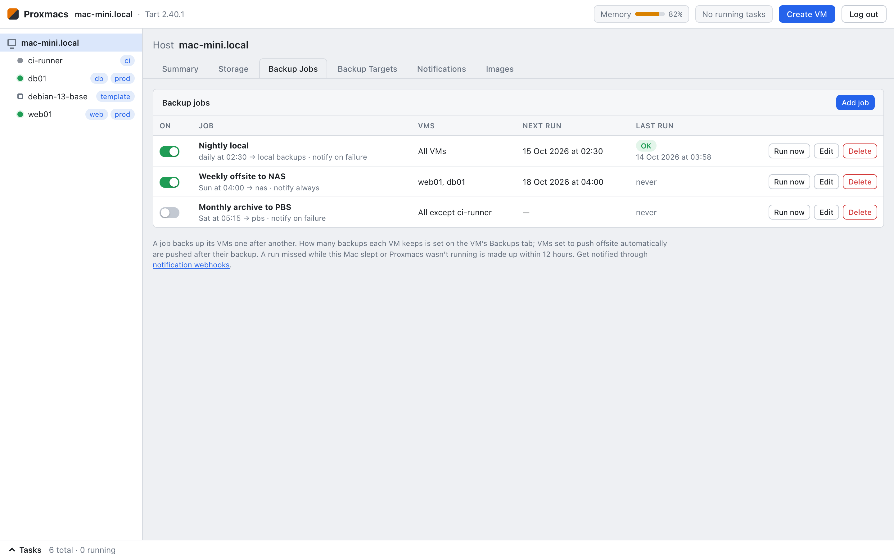 Scheduled backup jobs |
| 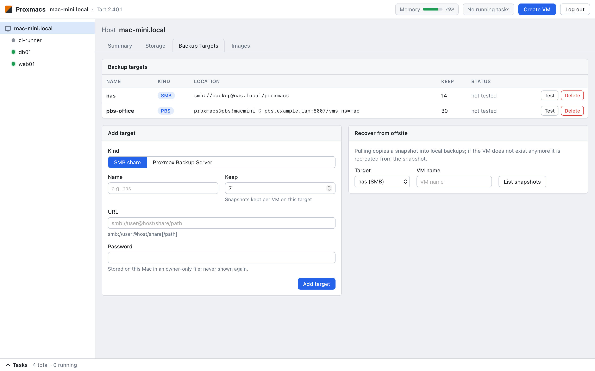 Offsite targets (SMB, Proxmox Backup Server) | 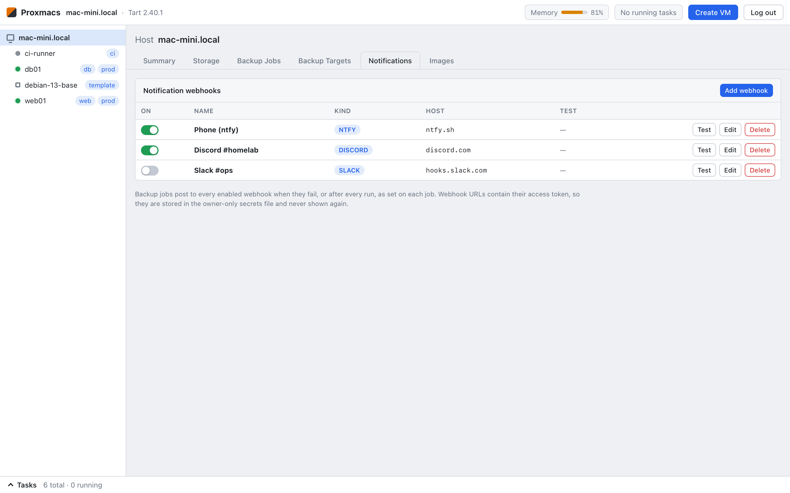 Notification webhooks (Discord, Slack, ntfy, JSON) |
| 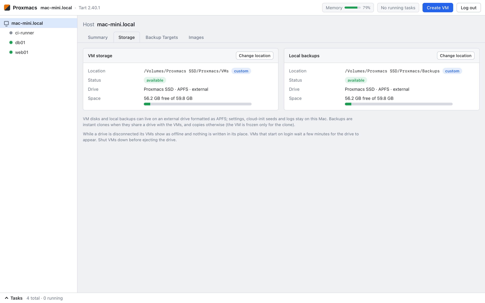 VM disks and backups on an external drive | 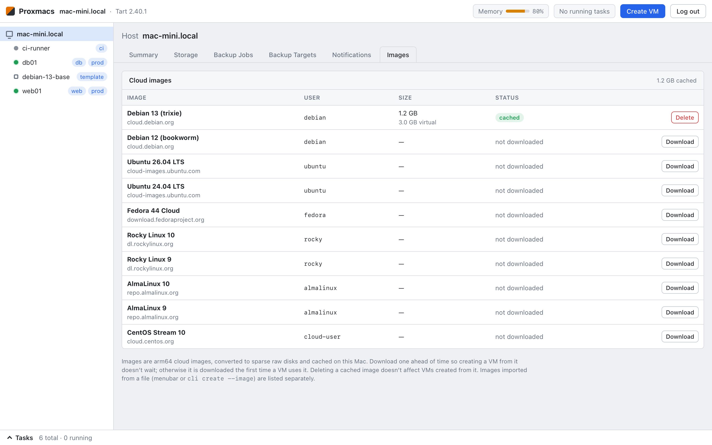 Cloud image catalog |
| 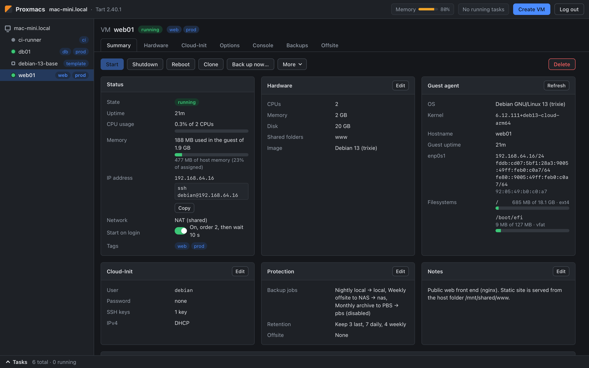 Dark mode | 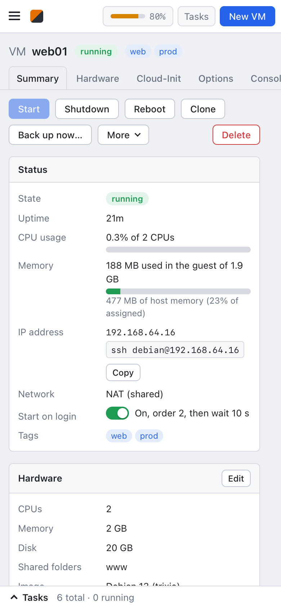 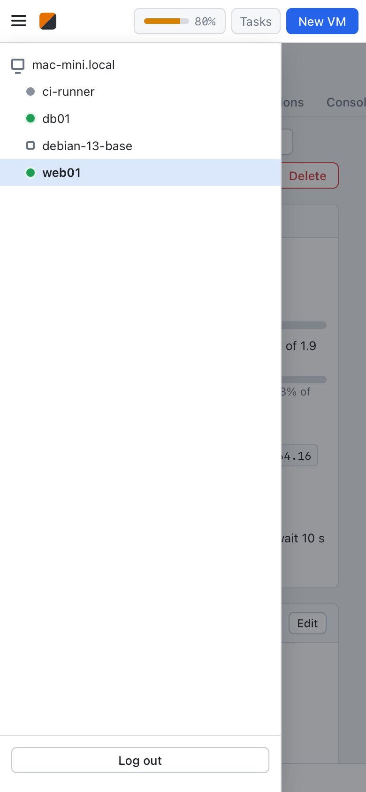<br>On a phone |

Regenerate them with `scripts/docs-screenshots.swift` (see the comment at its top).

## Why Tart

- **Bridging needs an entitlement only Apple can grant.**
  - Virtualization.framework's bridged network attachment needs `com.apple.vm.networking`.
  - Apple hands that entitlement out per developer, through a provisioning profile, so an ad-hoc or self-signed app
    can't have it.
  - Tart's official build carries it. Running that binary gives VMs native bridging with no root helper, no
    `socket_vmnet` and no kernel extension.
  - The alternatives cost more: QEMU or a self-built VZ app would need a privileged daemon for bridging, or would be
    limited to NAT.
- **It already does the VM plumbing.**
  - Tart handles the VM bundle (config, disk, NVRAM, MAC), EFI boot of Linux guests and the serial console.
  - Its guest agent supplies VM IPs (`tart ip --resolver agent`, which also works on bridged VMs) and runs commands
    in the guest (`tart exec`). Backups use `tart exec` to freeze the filesystem.
- **Proxmacs stays simple.**
  - It shells out to the `tart` binary and doesn't link Virtualization.framework.
  - It needs no entitlements or sandbox, and works as an ad-hoc-signed build from source.
  - The boundary is a CLI, so Tart can be upgraded on its own, and Tart's license (FSL-1.1-ALv2, fine for personal
    and internal use) stays separate from Proxmacs's AGPL code.

## Requirements

```bash
brew trust openai/tools && brew install openai/tools/tart
```

Use the Homebrew build. A Tart built from source lacks the bridging entitlement.

## Build & run

```bash
./scripts/build-app.sh && open build/Proxmacs.app     # needs Node.js for the web UI
swift test
```

Web UI development: `npm --prefix web run build` produces `web/dist`, which a debug build serves directly. For hot
reload, run `npm --prefix web run dev` (Vite on :5173) next to a running Proxmacs. It proxies `/api` to
`PROXMACS_URL` (default `https://127.0.0.1:8006`).

## CLI

The same binary has a scriptable mode that shares code with the menubar:

```bash
P=build/Proxmacs.app/Contents/MacOS/Proxmacs
$P cli images                                          # catalog and cached images
$P cli image-pull ubuntu-24.04                         # download ahead of time (image-rm removes it)
$P cli create web1 --bridged en10 --disk 20 --password secret
$P cli create app1 --nat --image rocky-10              # user defaults to the image's (rocky)
$P cli create db1 --nat --user admin --ssh-keys ~/.ssh/id_ed25519.pub --ip 192.168.64.50/24 --gateway 192.168.64.1
$P cli edit web1 --cpus 4 --memory 8192 --disk 40      # VM stopped
$P cli edit web1 --password --dhcp                     # prompts; applied on next start
$P cli list
$P cli info web1                                       # settings, usage, guest OS, addresses, filesystems
$P cli reboot web1                                     # stop --force / reboot --force: turn off / reset
$P cli disk-add web1 50                                # VM stopped; /dev/vdb in the guest
$P cli share-add web1 src ~/src --ro                   # VM stopped; /mnt/shared/src in the guest
$P cli set web1 --tags web,prod --autostart on --order 1 --delay 30 --nested on
$P cli clone web1 web2 --start --ip 192.168.64.51/24   # or --dhcp; a running source is fine
$P cli template base && $P cli clone base app2         # templates can only be cloned
$P cli backup web1 && $P cli backups web1
$P cli backup web1 --to pbs1                           # straight to an offsite target, no local backup
$P cli stop web1 && $P cli restore web1 0 && $P cli start web1
```

### Backup jobs and notifications

```bash
$P cli set web1 --keep-last 3 --keep-daily 7 --keep-weekly 4 --keep-monthly 6   # retention (PBS prune semantics)
$P cli job-add --at 02:30 --days weekdays --exclude scratch --notify failure --comment Nightly
$P cli job-add --at 04:00 --days sun --to pbs1 --comment "Weekly to PBS"       # destination: an offsite target
$P cli jobs && $P cli job-run <id>
$P cli notify-add discord --format discord             # prompts for the webhook URL (kept secret)
$P cli notify-add phone --format ntfy                  # e.g. https://ntfy.sh/<long-random-topic>
$P cli notify-test phone
```

### Offsite

```bash
$P cli target-add smb nas smb://backup@nas.local/vmbackups/proxmacs --keep 14   # prompts for the password
$P cli target-add pbs pbs1 --host pbs.lan --datastore store1 --auth-id 'proxmacs@pbs!mac' \
      --fingerprint 'aa:bb:…' --keep 14                                           # prompts for the token secret
$P cli target-test pbs1
$P cli push web1 pbs1            # newest local backup → PBS
$P cli remote pbs1 web1          # list snapshots
$P cli pull pbs1 web1            # newest snapshot → local backups (recreates web1 if it's gone)
$P cli verify pbs1 web1          # read the newest snapshot back and check every chunk
```

The PBS token needs `DatastoreBackup` on the datastore, or the namespace if you use one. Pruning remote
snapshots also needs `Datastore.Prune`; without it, pushes still succeed and the task notes that pruning failed.

### Storage

```bash
$P cli storage                                         # where VM disks and backups live, free space
$P cli storage vms /Volumes/External/Proxmacs/VMs       # all VMs shut down; moves every VM's disk
$P cli storage backups /Volumes/External/Proxmacs/Backups
$P cli storage vms --default                           # back to ~/.tart
```

How custom locations behave:

- **Choosing a folder.** It must be on an APFS volume (sparse files, clones) and must not be the drive's root. It has
  to be new, empty, or already a Proxmacs folder of the same kind. In the last case, for example a reconnected drive,
  the data there is adopted without copying.
- **Marker file.** Each custom folder gets a `.proxmacs-storage` file. Without it, for instance when the drive is
  unplugged, the location counts as unavailable:
  - VMs show as `offline` and actions fail with a clear message.
  - Tart is never pointed at an empty folder in its place.
  - VMs that start on login wait up to 3 minutes for the drive to mount.
- **Moving data.** The copy completes before the old data is removed (a plain rename within one volume), so a failed
  move changes nothing.
- **Same drive or not.** With VMs and backups on the same volume, backups are instant clones. Otherwise, the VM is
  cloned on its own volume while frozen and copied after it thaws.
- **Plain `tart`.** To see the VMs with the `tart` command, set `TART_HOME` to the VM storage folder.

### Web UI

```bash
$P cli web-passwd                # or Proxmacs menu → Web UI → Set Password…
$P cli serve                     # headless, without the menubar
$P cli api-key-add backup-script # or Proxmacs menu → Web UI → API Keys…; printed once
$P cli api-keys                  # list; api-key-rm <name> revokes
```

Programs call the API with `Authorization: Bearer pmx_…`. For now a key can do everything the admin password can.
The API is documented in [docs/API.md](docs/API.md).

Settings live in `web.json` (`enabled`, `port` 8006, `bind` 0.0.0.0, `tls` true). Host → Summary lists every
address the web UI listens on. The self-signed certificate's
SHA-256 fingerprint is printed by `serve`, so you can check it against the browser warning.

**Install as an app**: on iPhone/iPad, Safari → Share → Add to Home Screen; on Android or desktop Chrome/Edge, the
browser menu → Install app (or Add to Home screen). It opens full screen with its own icon. Browsers fully install web
apps only from origins with a trusted certificate, so with the self-signed one Chrome may only add a shortcut that
opens a browser tab. Install the certificate on the device, or put Proxmacs behind a reverse proxy with a trusted
certificate (`tls` false, `bind` 127.0.0.1), for a full install. Icons are generated by
`swift scripts/make-web-icons.swift web/public/icons`.

## Layout

| Path | Contents |
| --- | --- |
| `~/Library/Application Support/Proxmacs/images/` | cached base images (`<id>-arm64.raw`, imported `*.raw`) and the agent `.deb`/`.rpm` |
| `~/Library/Application Support/Proxmacs/vms/<name>/` | `meta.json` (incl. cloud-init settings), `seed.iso` (cloud-init), `provision.json`, `run.log`, `console.log` |
| `~/Library/Application Support/Proxmacs/backups/<name>/<timestamp>/` | cloned `disk.img`, extra disks, `nvram.bin`, `config.json` (or `<backup storage>/<name>/…`) |
| `~/Library/Application Support/Proxmacs/storage.json` | custom VM / backup storage locations |
| `~/Library/Application Support/Proxmacs/offsite.json` | offsite targets |
| `~/Library/Application Support/Proxmacs/jobs.json` | backup jobs |
| `~/Library/Application Support/Proxmacs/notifications.json` | notification webhooks (URLs are in `secrets.json`) |
| `~/Library/Application Support/Proxmacs/secrets.json` | SMB passwords, PBS token secrets, webhook URLs, web password hash (mode 0600) |
| `~/Library/Application Support/Proxmacs/web.json` | web UI settings |
| `~/Library/Application Support/Proxmacs/apikeys.json` | API keys: names and SHA-256 hashes (mode 0600); last use in `apikeys-used.json` |
| `~/Library/Application Support/Proxmacs/web/` | self-signed `cert.pem` / `key.pem` |
| `~/.tart/vms/<name>/` | Tart's VM (owned by Tart) plus extra disks `disk<N>.img`, or `<VM storage>/vms/<name>/` |
| `~/Library/LaunchAgents/dev.proxmacs.vm.<name>.plist` | per-VM runner |

## Uninstall

```bash
./scripts/uninstall.sh --dry-run     # show what would be removed
./scripts/uninstall.sh               # asks you to type 'uninstall'
```

The script quits the app and stops every Proxmacs VM. It then removes:

- their launch agents
- their Tart VMs
- the data directory: settings, secrets, certificate, seeds, logs, cached images and local backups
- custom VM / backup storage folders on external drives, if connected (only folders carrying the Proxmacs marker)
- the app bundle(s), preferences, caches and the console sockets

Options: `--keep-vms`, `--keep-backups`, `--keep-app`, `--yes`. Tart itself, Tart VMs that Proxmacs didn't create,
and snapshots already pushed to SMB or PBS are left alone.

## Notes

- Only arm64 guests boot. amd64 cloud images are rejected.
- Changing the cloud-init user adds a new account; the old one is kept. VMs created before cloud-init settings were
  stored show the password as "unchanged since creation" and leave it alone until you set or remove one.
- Bridge over wired Ethernet. Wi-Fi access points often drop frames from bridged MACs.
- Local backups protect against mistakes, not disk failure, unless they're on another drive. Push them offsite
  (SMB/PBS) for real protection.
- Shut VMs down before ejecting a drive that holds their disks.
- Backups freeze only the guest's root filesystem; filesystems on extra disks are crash-consistent.
- Usage history is kept in memory, so charts start over when Proxmacs restarts. Guest network and memory figures
  need the guest agent.
- Mounting shared folders and the clone identity reset come with the cloud-init seed. VMs restored
  without a seed (recreated from a backup) mount shares only by hand:
  `sudo mount -t virtiofs com.apple.virtio-fs.automount /mnt/shared`.
- Tart can't combine NAT and bridged networking in one VM, so VMs have a single network card.
- cloud-init records each first-boot step as done when it starts it, so a VM stopped during its first boot would
  never get the guest agent, users or SSH host keys. Proxmacs notices that provisioning didn't finish (the guest
  writes a marker last, read through the agent) and rebuilds the seed with a new instance-id on the next start, so
  cloud-init starts over (at most twice).
- Secrets are kept in an owner-only file rather than the Keychain: the login Keychain prompts after every rebuild
  of an ad-hoc-signed binary.

## System-managed macOS VMs and browser consoles

This fork can integrate existing launchd-managed macOS VMs without replacing their owner or networking.
Set `TART_HOME` to their existing storage and add normal Proxmacs VM metadata with autostart disabled.
The system services remain responsible for boot-time startup. In the Proxmacs support directory,
`external-vms.json` identifies services and their verified virtual disk capacity:

```json
{
  "mac-build": {
    "service": "system/com.example.tart.mac-build",
    "ip": "192.0.2.2",
    "diskGB": 200,
    "consoleFile": "/srv/tart/vms/mac-build/.proxmacs-console/session.json"
  }
}
```

Use a launchctl service target such as `system/com.example.tart.mac-build` for `service`.
The catalog does not enable read-only mode. Direct app launch opens the web dashboard.
The integration exposes power controls, offline hardware changes, local backups/restore and offsite controls.
Configure your existing lifecycle command and a narrowly privileged owner helper in `external-control.json`:

```json
{
  "powerCommand": "/absolute/path/to/vmctl",
  "ownerHelper": "/absolute/path/to/restricted-owner-helper",
  "ownerUser": "vmowner",
  "reservedMemoryMB": 16384
}
```

The power command receives `start|stop|restart VM`; it must coordinate the system service and wait for the operation.
The helper runs through `sudo -n -H -u ownerUser` and receives `VM stop 0` or `VM set CPU MEMORY_MB DISK_GB`.
Install and validate your deployment's restrictive sudoers policy separately; the web process does not need root.
Networking remains managed by the existing system launcher. macOS backups cleanly shut down and resume running VMs.
Save guest work first. Restore requires a stopped VM and verified capacity in the backup record; ASIF file length
is not virtual capacity. System-service deletion, macOS creation/cloning, extra disks/shares and autostart edits
are not implemented. Linux VMs retain the upstream lifecycle and serial console.

### Graphical Console

The macOS Console tab embeds [noVNC](https://novnc.com/): keyboard and mouse control are enabled by default,
with a compact toolbar, view-only mode, fit/actual-size scaling, fullscreen and reconnect controls.
Type clipboard reads text on the browser device after a click, then previews it hidden by default.
If clipboard access is denied, paste manually with Command-V (Mac) or Control-V. Select the destination
field in the guest first. The confirmed text is sent as individual key events; Enter is never appended.
Line breaks and Tab require an explicit opt-in because they can submit forms or move focus.
Stop cancels remaining characters; it cannot undo characters already sent. Switching VM, disconnecting
or hiding the page cancels the queue; it is never replayed after reconnect. Text is not saved or logged.
Unicode and keyboard-layout compatibility depend on the Apple VNC server and must be verified in the guest.
It uses Tart's **experimental** `--vnc-experimental` display server, not guest Screen Sharing.
Compatibility depends on Apple's private VNC implementation; verify it before relying on recovery access.

**Real-host compatibility:** Tart 2.40.1 on macOS 27.2 beta (26B5091g) binds a wildcard VNC socket
(`*:port`) even though it prints a localhost URL. This was reproduced without a VM. The default loopback-only
supervisor rejects it. The optional PF deployment below permits wildcard VNC only while a root-owned monitor
reports that the dedicated VM owner's inbound sockets are protected. Never simply disable the listener check.

`scripts/console-runner.py` runs as the VM owner, captures the VNC URL before it reaches logs, and publishes a
per-boot endpoint with mode 0600 and an ACL granting the panel account read access. The socket must be loopback-only
or covered by the explicitly configured PF monitor. Credentials are removed when Tart exits. A supervisor failure
pauses the system launcher and terminates that VM process; test on a guest that can be safely stopped first.

For an existing root-owned Bash launcher that sets `TART_HOME` and uses `exec "$TART_BIN" run ...`, the installer
preserves its network flags, keychain setup and pause handling. Review the launcher, then run:

```bash
python3 scripts/install-console-launcher.py --check \
  --launcher '/absolute/path/to/run-vm.sh' --python /absolute/path/to/python3 --reader paneluser
sudo python3 scripts/install-console-launcher.py \
  --launcher '/absolute/path/to/run-vm.sh' --python /absolute/path/to/python3 --reader paneluser
```

The installer backs up the launcher as `run-vm.sh.pre-proxmacs-console` and does **not** restart any VM.
Enable it per VM by creating `<TART_HOME>/vms/<name>/.console-enabled`, then coordinate a full shutdown/start.
Point `consoleFile` at the runtime `session.json` as shown above. Without the marker, the supervisor immediately
executes the original Tart command. Removing the marker and starting again disables VNC without another root operation.
If the loopback check fails, remove the enable marker before using the normal lifecycle tool to resume the paused VM.
Full launcher rollback uses the same installer command with `--rollback`, followed by a coordinated shutdown/start.
Never use the upstream uninstall script against these existing services.


#### Optional PF protection for wildcard Apple VNC

This deployment needs a **dedicated VM service account**, a different panel account, stock Apple root PF anchor
layout (including a trailing Apple Internet Sharing anchor), and an SSH-accessible machine on the same network for IPv4/IPv6 probes. The PF rule blocks new inbound TCP
connections to sockets owned by that account on every interface except `lo0`. It has no port number, so it is in
place before Tart allocates a random VNC port. The SYN filter preserves replies to outbound host connections;
forwarded guest traffic has no matching local socket owner. Guest network access must still be verified after installation.

Review and run (replace the example paths, accounts, SSH alias and host addresses):

```bash
python3 scripts/install-console-pf.py --check \
  --launcher '/absolute/path/to/run-vm.sh' --python /absolute/path/to/python3 \
  --owner vmowner --reader paneluser --probe-ssh lan-probe \
  --probe-v4 192.0.2.10 --probe-v6 'fe80::1%en0'
sudo /usr/bin/python3 -I scripts/install-console-pf.py \
  --launcher '/absolute/path/to/run-vm.sh' --python /absolute/path/to/python3 \
  --owner vmowner --reader paneluser --probe-ssh lan-probe \
  --probe-v4 192.0.2.10 --probe-v6 'fe80::1%en0'
```

`--python` must match the Python path in an already-installed console launcher. The probe addresses identify the
**host**, as reached from the SSH probe machine; the IPv6 zone identifies that machine's network interface.
The SSH probe uses the panel account's existing config and pinned host keys, without password prompts.

The installer:
- Refuses unknown launcher edits, existing unrelated PF policy and already-running experimental VNC processes.
- Uses only `com.apple/000.proxmacs-console`, retaining its own `pfctl -E` reference. It never edits `/etc/pf.conf`.
  If PF is disabled and completely empty, it can initialize the verified stock Apple configuration; active or
  nonstandard empty-root configurations require manual review instead of a global reload.
- Installs `org.proxmacs.console-pf` as a root LaunchDaemon, using system Python in isolated mode. Its files,
  Root-owned backups and logs live in `/Library/Application Support/ProxmacsConsolePF`.
- Proves both IP families using disposable wildcard TCP listeners: loopback must work, remote listeners owned
  by the panel account must be reachable, and remote listeners owned by the VM account must be blocked.
  An SSH failure does not count as successful isolation. Only then does it update the VM launcher.
- Leaves console enable markers and running VMs untouched. On installation failure it restores the launcher
  and removes its own PF rules/reference; diagnostics remain for inspection. An unchanged failed/rolled-back
  installation can be retried with the same command; previous diagnostics are archived.

At boot the supervisor waits up to 15 seconds for the PF monitor, then starts the VM **without VNC** if protection
is unavailable. The monitor checks PF state, root anchor ordering, the exact owner rule and interface skipping.
It does not overwrite policy changes detected while running. Its root-owned readiness record expires after six
seconds, and the supervisor polls every half second. **Loss of protection during an active console forcibly stops
that VM**, removes its credentials and creates the pause marker. This watchdog is not an atomic barrier against
an administrator disabling PF: there is a detection interval. Stop console-enabled VMs before PF maintenance.
Recovery is removing `.console-enabled` and resuming through the existing lifecycle tool.

Verify the policy/probes again, or roll back **after stopping console-enabled VMs**:

```bash
sudo /usr/bin/python3 -I scripts/install-console-pf.py --verify
sudo /usr/bin/python3 -I scripts/install-console-pf.py --rollback
```

Rollback checks for later launcher edits, restores the saved launcher/supervisor, unloads the monitor and releases
only its own anchor and PF reference. It does not flush other rules/states or globally disable PF. Backups remain.
The PF network tests require root and a real remote peer; unit tests below do not substitute for them.

This remains an experimental Apple display server. During a real deployment on Tart 2.40.1 / macOS 27.2 beta
(26B5091g), a raw TCP/RFB diagnostic connection coincided with a Tart SIGTRAP in Apple's
`_VZVirtualMachineAccessor addAccessorObserver:` / `_VZVNCServer _setupVirtualMachineAccessor`.
A subsequent occurrence of the same Apple assertion was observed without an intentional raw VNC probe.
The guest service restarted automatically. The exact trigger and concurrent-viewer behavior
have not been established; do not treat this as a production stability guarantee or use raw VNC banner probes
as a health check. The installer probes disposable TCP servers, not the running Apple VNC server.


The browser obtains current credentials through an authenticated, non-cacheable same-origin POST, then connects
through the panel's WebSocket endpoint. Ports and passwords are not placed in URLs. The server verifies the
endpoint PID against Tart's POSIX config lock and checks it again during a connection; logout or a replaced
VM session closes the connection within two seconds. Only a current browser login with a matching Origin can
use the graphical console. Reverse proxies must preserve the expected HTTPS scheme and Host; direct HTTPS is
the supported deployment. Do not publish the raw VNC listener.

Validation:

```bash
npm --prefix web ci
npm --prefix web run build
PROXMACS_HEADLESS=1 swift build -c release
PROXMACS_HEADLESS=1 PROXMACS_SUPPORT_DIR=/tmp/proxmacs-tests-support TART_HOME=/tmp/proxmacs-tests-tart swift test -c release
node --experimental-strip-types --test scripts/test-console-text.mjs # Node 22.6+
PYTHONDONTWRITEBYTECODE=1 python3 scripts/test-console-runner.py
PYTHONDONTWRITEBYTECODE=1 python3 scripts/test-console-pf.py
PYTHONDONTWRITEBYTECODE=1 python3 scripts/test-console-integration.py --binary /absolute/path/to/built/Proxmacs
```

The integration check creates and removes isolated storage and a loopback RFB fixture; no real VM is used.
It checks login/Origin restrictions, WebSocket data flow, logout, stale endpoints, permissions and secret redaction.
The fixture also supports VNC password authentication and a colored framebuffer for manual noVNC/input checks.
Full Swift tests need an Xcode installation with XCTest; some Command Line Tools distributions cannot run them.
`PROXMACS_HEADLESS=1` excludes the native SwiftUI menu when its macros are unavailable; CLI and web UI remain usable.
Third-party notices ship under `/licenses/novnc/` in the web assets.
